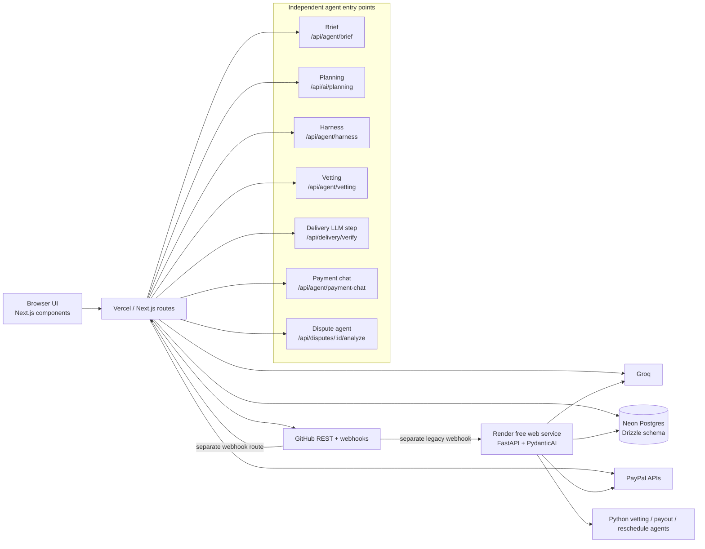

# ConsultAI

ConsultAI is a Next.js application for turning a project brief into a
milestone plan, vetting consultant candidates, checking GitHub delivery
evidence, and funding or paying milestones through PayPal. The repository also
contains a separate FastAPI service intended for Render deployment. The
Next.js application and the FastAPI service are not connected by a call in the
current codebase.

The implementation is a mixture of working database-backed flows and explicit
demo/stub surfaces. This document describes the code as it exists today; it
does not describe planned behavior.

## What exists today

| Area | Current implementation |
|---|---|
| Web application | Next.js 16, React 19, TypeScript |
| Database | Neon Postgres through Drizzle and `DATABASE_URL` in the Next.js app |
| AI provider | Groq through the Vercel AI SDK in Next.js; PydanticAI/Groq in the FastAPI service |
| Planning UI | AG Grid backlog plus Bryntum Gantt |
| Source control | GitHub REST API and signed GitHub webhooks |
| Payments | PayPal Orders, Captures, Payouts, disputes, and webhooks |
| Tests | Vitest and Playwright scripts are present |
| Hosted services | Vercel-compatible Next.js deployment and a separate Render Python web service |

Important source areas are [app/](/home/axelnez/.bob/playground/consultai/app),
[components/](/home/axelnez/.bob/playground/consultai/components),
[lib/](/home/axelnez/.bob/playground/consultai/lib), and
[backend/](/home/axelnez/.bob/playground/consultai/backend).

## End-to-end flows

### 1. Create a brief and save a project plan

The new-project UI is
[NewProjectClient.tsx](</home/axelnez/.bob/playground/consultai/app/(company)/project/new/NewProjectClient.tsx>).
It renders the brief chat from
[ChatPanel.tsx](/home/axelnez/.bob/playground/consultai/components/agent/ChatPanel.tsx),
shows a plan preview, and lets the company approve the generated plan.

The current flow is:

1. The browser sends the brief and chat messages to
   `POST /api/agent/brief`, implemented by
   [app/api/agent/brief/route.ts](/home/axelnez/.bob/playground/consultai/app/api/agent/brief/route.ts).
2. That route streams Markdown from Groq. The model is selected by
   `LLM_GROQ_MODEL` and defaults to `qwen/qwen3-32b`.
3. The model is instructed by
   [lib/brief/tools.ts](/home/axelnez/.bob/playground/consultai/lib/brief/tools.ts)
   to emit a fenced JSON plan. **The route currently passes no tools to
   `streamText`; the `saveStructuredBrief` and `askClarification` tool
   definitions in that file are not exposed by this route.**
4. The UI extracts the JSON plan and displays an **Approve & Save Plan**
   button. Approval calls `POST /api/db/save-brief`, implemented by
   [app/api/db/save-brief/route.ts](/home/axelnez/.bob/playground/consultai/app/api/db/save-brief/route.ts).
5. The save route validates and normalizes the plan with
   [lib/brief/schema.ts](/home/axelnez/.bob/playground/consultai/lib/brief/schema.ts),
   writes `projects.structured_plan`, deletes only existing `planned`
   milestones, inserts new `milestones` rows, and schedules a deferred
   `brief_drafts` and `audit_log` write.
6. During editing, the browser also debounces a draft to
   `POST /api/agent/brief-draft`, implemented by
   [app/api/agent/brief-draft/route.ts](/home/axelnez/.bob/playground/consultai/app/api/agent/brief-draft/route.ts).

**Database tables:** `projects`, `milestones`, `brief_drafts`, and
`audit_log`, defined in
[lib/db/schema.ts](/home/axelnez/.bob/playground/consultai/lib/db/schema.ts).

**Limitations:** the plan is generated by an LLM and must be approved by the
company UI before the database save. If the LLM fails, the UI offers a manual
plan editor. The generated plan is not itself a payment authorization.

### 2. Project planning: AG Grid and Bryntum Gantt

The `/planning` page is
[app/(company)/planning/page.tsx](</home/axelnez/.bob/playground/consultai/app/(company)/planning/page.tsx>).
Its database-loading and dependency-building functions are currently TODOs:
they return empty arrays. Consequently, the page renders the default seed data
inside [BryntumGantt.tsx](/home/axelnez/.bob/playground/consultai/components/bryntum-gantt/BryntumGantt.tsx)
and the default unscheduled list from
[UnscheduledTasksGrid.tsx](/home/axelnez/.bob/playground/consultai/components/bryntum-gantt/UnscheduledTasksGrid.tsx).
It does **not** currently load project milestones or dependencies from Neon.

The client layout is
[PlanningLayout.tsx](/home/axelnez/.bob/playground/consultai/components/bryntum-gantt/PlanningLayout.tsx):

- AG Grid displays eight hardcoded unscheduled tasks.
- A Bryntum `DragHelper` listens for AG Grid row drags and adds a normalized
  task to the Gantt task store.
- The task is removed from the local backlog after insertion.
- The Gantt also supports its own editing, dependencies, task movement, and
  toolbar Undo/Redo calls.
- `onTaskChange` only logs changes; it does not persist them.

The planning chat is
[GanttChatPanel.tsx](/home/axelnez/.bob/playground/consultai/components/bryntum-gantt/GanttChatPanel.tsx).
Its callback in `PlanningLayout` calls `POST /api/ai/planning`, implemented by
[app/api/ai/planning/route.ts](/home/axelnez/.bob/playground/consultai/app/api/ai/planning/route.ts).
That route uses Groq (default `llama-3.1-8b-instant`) and exposes one tool,
`scheduleTask`. The response contains Markdown plus structured tool calls; the
client validates that the task is still in the local unscheduled list before
inserting it into Bryntum.

**Database tables:** none are read or written by the current `/planning` page,
Gantt drag path, or planning AI route. The project and milestone tables exist
in the schema, but this planning surface does not use them yet.

### 3. Consultant vetting

The company vetting page invokes `POST /api/agent/vetting`, implemented by
[app/api/agent/vetting/route.ts](/home/axelnez/.bob/playground/consultai/app/api/agent/vetting/route.ts).
Consent is recorded first through
`PUT /api/agent/vetting/consent`, implemented by
[app/api/agent/vetting/consent/route.ts](/home/axelnez/.bob/playground/consultai/app/api/agent/vetting/consent/route.ts).

The pipeline in
[lib/vetting/orchestrator.ts](/home/axelnez/.bob/playground/consultai/lib/vetting/orchestrator.ts)
is:

1. Load the candidate and require `vettingConsentAt`.
2. Fetch public GitHub repositories and, when applicable, GitHub PR files using
   [github-fetcher.ts](/home/axelnez/.bob/playground/consultai/lib/vetting/github-fetcher.ts).
3. Fetch a candidate portfolio URL through the SSRF-safe helper in
   [ssrf-safe-fetch.ts](/home/axelnez/.bob/playground/consultai/lib/vetting/ssrf-safe-fetch.ts);
   LinkedIn URLs are blocked.
4. Ask Groq to extract requirement-linked facts in
   [llm-extraction.ts](/home/axelnez/.bob/playground/consultai/lib/vetting/llm-extraction.ts).
   Quoted excerpts are checked against the fetched content.
5. Compute confidence, the score breakdown, and the candidate matrix in code
   using [signals.ts](/home/axelnez/.bob/playground/consultai/lib/vetting/signals.ts).
6. Persist signals and update the candidate record. An audit entry is also
   written.

**Database tables:** `candidates`, `projects`, `signals`, and `audit_log`.

The returned report always includes a human-review notice. The LLM extracts
evidence only; it does not set the trust score or matrix state. If fetching or
LLM extraction fails, the pipeline continues where possible and can return an
unknown/zero-signal result.

### 4. Delivery verification from GitHub pull requests

The primary on-demand verification route is
`POST /api/delivery/verify`, implemented by
[app/api/delivery/verify/route.ts](/home/axelnez/.bob/playground/consultai/app/api/delivery/verify/route.ts).
It accepts a milestone ID, GitHub PR URL, and optional expected author. It:

1. Validates the PR URL and optional `DELIVERY_AGENT_REPO` restriction.
2. Fetches PR metadata, changed files, check runs, and reviews through
   [github-client.ts](/home/axelnez/.bob/playground/consultai/lib/delivery/github-client.ts).
3. Runs deterministic checks and flags in
   [verifier.ts](/home/axelnez/.bob/playground/consultai/lib/delivery/verifier.ts).
4. Uses the Groq-backed structured-output step in
   [llm-step.ts](/home/axelnez/.bob/playground/consultai/lib/delivery/llm-step.ts)
   only for justification and subjective assessments.
5. Validates evidence references and evaluates the deterministic policy engine
   in [policy-engine.ts](/home/axelnez/.bob/playground/consultai/lib/delivery/policy-engine.ts).
6. Stores the run, ordered agent steps, and payment proposal, and writes an
   audit event.

`GET /api/delivery/run/[runId]`, implemented by
[app/api/delivery/run/[runId]/route.ts](</home/axelnez/.bob/playground/consultai/app/api/delivery/run/[runId]/route.ts>),
returns the run, `agent_steps`, and proposals for polling. Company approval is
handled by
[app/api/delivery/propose/approve/route.ts](/home/axelnez/.bob/playground/consultai/app/api/delivery/propose/approve/route.ts);
approval re-checks the PR HEAD SHA before calling the PayPal payout route.

**Database tables:** `milestones`, `projects`, `verification_runs`,
`agent_steps`, `payment_proposals`, `payments`, and `audit_log`.

The policy engine is fail-closed by default: `AUTO_RELEASE_LIMIT_USD` defaults
to zero, and flags, subjective criteria, unassessed criteria, amount limits, or
a changed SHA require approval. The delivery LLM cannot change that decision.

#### GitHub webhook path

`POST /api/github/webhook`, implemented by
[app/api/github/webhook/route.ts](/home/axelnez/.bob/playground/consultai/app/api/github/webhook/route.ts),
is a separate implementation. It handles `pull_request` actions `opened`,
`synchronize`, and `reopened`, plus `push` events. It matches the repository to
`projects.github_repo_url`, selects the first active milestone, fetches PR
files (or push commit metadata), and asks Groq to evaluate the milestone
criteria. When the result passes `MILESTONE_EVAL_THRESHOLD` (default `0.6`),
it advances the milestone to `submitted` and writes audit events.

This webhook route does **not** call `/api/delivery/verify`, does not create a
`verification_runs` row or `payment_proposals` row, and does not move money.
Its database tables are `projects`, `milestones`, and `audit_log` (plus GitHub
API data fetched at request time).

### 5. Pay on Delivery with PayPal

Funding and payout are distinct operations:

1. `POST /api/paypal/create-order` reads a `planned` milestone, creates a
   PayPal Orders v2 order, and inserts a pending `payments` row.
2. `POST /api/paypal/capture-order` captures the approved order, records the
   PayPal gross/fee/net breakdown, and moves the milestone toward `funded`.
3. `POST /api/paypal/webhook`, implemented by
   [app/api/paypal/webhook/route.ts](/home/axelnez/.bob/playground/consultai/app/api/paypal/webhook/route.ts),
   verifies PayPal transmission signatures and applies idempotent payment and
   milestone transitions using `paypal_webhook_deliveries`.
4. A payout can be issued by `POST /api/paypal/payout`, approved through
   `POST /api/paypal/payout/approve`, or initiated after a delivery proposal is
   approved. The payout implementation is in
   [lib/payments/direct-payout.ts](/home/axelnez/.bob/playground/consultai/lib/payments/direct-payout.ts).
5. Disputes are shown by
   [DisputeView.tsx](/home/axelnez/.bob/playground/consultai/components/payments/DisputeView.tsx).
   The dispute agent drafts a response through
   `POST /api/disputes/[disputeId]/analyze`; the human-approved actions call
   the PayPal dispute routes under [app/api/paypal/dispute/](/home/axelnez/.bob/playground/consultai/app/api/paypal/dispute/).

**Database tables:** `milestones`, `payments`, `approvals`, `disputes`,
`paypal_webhook_deliveries`, and `audit_log`.

The UI surfaces are in
[MilestoneFundButton.tsx](/home/axelnez/.bob/playground/consultai/components/payments/MilestoneFundButton.tsx),
[MilestonePaymentPanel.tsx](/home/axelnez/.bob/playground/consultai/components/payments/MilestonePaymentPanel.tsx),
[MoneyFlowPanel.tsx](/home/axelnez/.bob/playground/consultai/components/payments/MoneyFlowPanel.tsx),
and [PaymentChatPanel.tsx](/home/axelnez/.bob/playground/consultai/components/payments/PaymentChatPanel.tsx).
PayPal calls are server-side and guarded by role checks, rate limits, idempotency
keys, and state transitions. The code also supports an explicit
`bypass_approval` payout path; it is not an immutable human-approval boundary.

## Agent orchestration

There is no central router agent. The application has independent agents and
LLM steps behind separate routes. A route may call a library pipeline or define
its own tools, but no Next.js agent invokes another Next.js agent.

### Agents and LLM steps

| Agent/step | Entry file and provider | Prompt | Tools | Returns |
|---|---|---|---|---|
| Brief planning agent | [app/api/agent/brief/route.ts](/home/axelnez/.bob/playground/consultai/app/api/agent/brief/route.ts); Vercel AI SDK + Groq, default `qwen/qwen3-32b` | `buildBriefAgentSystemPrompt` in [lib/brief/tools.ts](/home/axelnez/.bob/playground/consultai/lib/brief/tools.ts) | **None at runtime**; the route uses text-only `streamText` | UI message stream containing Markdown and a fenced JSON `BriefPlan` |
| Gantt scheduling agent | [app/api/ai/planning/route.ts](/home/axelnez/.bob/playground/consultai/app/api/ai/planning/route.ts); Vercel AI SDK + Groq, default `llama-3.1-8b-instant` | Inline `system` string in the route | `scheduleTask` | Markdown text plus `scheduleTask` calls |
| In-product harness | [app/api/agent/harness/route.ts](/home/axelnez/.bob/playground/consultai/app/api/agent/harness/route.ts); Vercel AI SDK + Groq `llama-3.1-8b-instant` | `SYSTEM_PROMPT` in the route | `filter_candidates`, `assign_candidate`, `reschedule_milestone`, `query_vetting_summary`, `smart_reschedule_gantt` | UI message stream with text and action/tool results; tools return client instructions and calculated updates |
| Payment chat agent | [app/api/agent/payment-chat/route.ts](/home/axelnez/.bob/playground/consultai/app/api/agent/payment-chat/route.ts); Vercel AI SDK + Groq, default `qwen/qwen3-32b` | `buildPaymentChatSystemPrompt` in [lib/payments/payment-chat-tools.ts](/home/axelnez/.bob/playground/consultai/lib/payments/payment-chat-tools.ts) | `getMilestoneStatus`, `listMilestones`, `getPendingApprovals`, `requestPayoutApproval`, `executeMilestonePayout` | UI message stream; the last tool can call `executeDirectPayout` and issue PayPal money |
| Vetting extraction step | [lib/vetting/llm-extraction.ts](/home/axelnez/.bob/playground/consultai/lib/vetting/llm-extraction.ts), called by [lib/vetting/orchestrator.ts](/home/axelnez/.bob/playground/consultai/lib/vetting/orchestrator.ts); Vercel AI SDK + Groq, default `qwen/qwen3-32b` | `buildExtractionPrompt` in the same file | None | Structured factual matches; code verifies excerpts and computes scores |
| Delivery verification LLM step | [lib/delivery/llm-step.ts](/home/axelnez/.bob/playground/consultai/lib/delivery/llm-step.ts); Vercel AI SDK + Groq, default `qwen/qwen3-32b` | `buildPrompt` in the same file | None | Structured justification and subjective assessments; deterministic policy remains authoritative |
| GitHub webhook evaluator | [app/api/github/webhook/route.ts](/home/axelnez/.bob/playground/consultai/app/api/github/webhook/route.ts); Vercel AI SDK + Groq, default `qwen/qwen3-32b` | Inline `evaluateMilestoneWithLLM` prompt | None | Criterion results, summary, and a trust score used to decide whether code advances the milestone to `submitted` |
| Dispute agent | [lib/disputes/dispute-agent.ts](/home/axelnez/.bob/playground/consultai/lib/disputes/dispute-agent.ts), called by [app/api/disputes/[disputeId]/analyze/route.ts](</home/axelnez/.bob/playground/consultai/app/api/disputes/[disputeId]/analyze/route.ts>); Vercel AI SDK + Groq, default `qwen/qwen3-32b` | `buildPrompt` in the same file | Read-only evidence access is assembled server-side; PayPal action functions are not LLM tools | A proposed dispute action, written response, offer amount, reasoning, and confidence; stored in `disputes.agent_resolution` |
| Python vetting agent | [backend/agents.py](/home/axelnez/.bob/playground/consultai/backend/agents.py); PydanticAI + Groq, default `llama-3.1-8b-instant` from `GROQ_MODEL` | `system_prompt` in `backend/agents.py` | None | `CandidateVettingResult` |
| Python payout-check agent | [backend/agents.py](/home/axelnez/.bob/playground/consultai/backend/agents.py); PydanticAI + Groq, default `llama-3.1-8b-instant` | `system_prompt` in `backend/agents.py` | None | `MilestonePayoutCheck`; the route overwrites `threshold_met` with the deterministic `trust_score >= 75 && tests_passing` rule |
| Python reschedule agent | [backend/agents.py](/home/axelnez/.bob/playground/consultai/backend/agents.py); PydanticAI + Groq, default `llama-3.1-8b-instant` | `system_prompt` in `backend/agents.py` | None | `TimelineReschedulePlan`; no current FastAPI route calls it |

The brief tool definitions in
[lib/brief/tools.ts](/home/axelnez/.bob/playground/consultai/lib/brief/tools.ts)
and the payment/harness tools are ordinary Vercel AI SDK tools, not an
orchestration framework.

### Who calls whom?

- Browser components call their own Next.js routes: the brief chat calls
  `/api/agent/brief`, planning chat calls `/api/ai/planning`, vetting calls
  `/api/agent/vetting`, payment chat calls `/api/agent/payment-chat`, and
  delivery/payment UI calls their corresponding routes.
- `/api/delivery/verify` calls GitHub client helpers, deterministic verifier,
  the delivery LLM step, and the policy engine. It does not call another
  agent route.
- `/api/github/webhook` independently calls its own Groq evaluator. It does not
  call `/api/delivery/verify`.
- `/api/disputes/[disputeId]/analyze` independently calls the dispute agent.
- Render's FastAPI webhook calls the Python vetting agent as a FastAPI
  `BackgroundTasks` task. Its payout endpoint calls the Python payout-check
  agent and then PayPal. No Next.js route in this repository calls the Render
  service, and the Python service does not call the Next.js routes.

No LangGraph, CrewAI, queue, cron scheduler, or custom state-machine
orchestrator is used for agent execution. The Vercel AI SDK does use bounded
multi-step tool execution in payment chat (`stepCountIs(8)`); the harness uses
the SDK stream/tool protocol and has a deterministic mock fallback. Payment
and milestone state transitions are separate deterministic code in
[lib/state-machines/milestone-payment.ts](/home/axelnez/.bob/playground/consultai/lib/state-machines/milestone-payment.ts).

### State, memory, and audit

Agents do not have durable conversational memory. Chat history is supplied by
the browser on each request. Durable domain state is in Neon through Drizzle
(`DATABASE_URL`) in the Next.js service. The Python service uses asyncpg and
`NEON_DATABASE_URL`.

There is no universal agent-run store. Delivery runs have `verification_runs`
and ordered `agent_steps`; dispute proposals are stored in `disputes`; brief
drafts are stored in `brief_drafts`; vetting evidence is stored in `signals`.
The append-only `audit_log` records selected domain and agent events, but it is
not a complete transcript or audit of every model decision/prompt.

### Deterministic safety boundary and money

Deterministic server code controls request validation, consent, SSRF checks,
GitHub evidence checks, objective acceptance criteria, score calculation,
payment state transitions, SHA re-checks, approval records, idempotency, and
webhook verification. LLM output is limited to generated plan text, extracted
evidence, justifications, subjective assessments, summaries, proposals, and
tool arguments.

The statement “no agent can move money directly” is **not true of the current
code**. The brief, vetting, delivery, planning, and dispute agents do not have
PayPal execution tools. However, `executeMilestonePayout` in
[lib/payments/payment-chat-tools.ts](/home/axelnez/.bob/playground/consultai/lib/payments/payment-chat-tools.ts)
directly calls `executeDirectPayout` with `bypass_approval: true`, and the
Python payout-check route calls PayPal after its deterministic threshold check.
Those calls still run server-side and enforce milestone/payment checks, but the
payment chat agent is not merely advisory.

## What Render does

[render.yaml](/home/axelnez/.bob/playground/consultai/render.yaml) defines one
free-plan Oregon Python web service:

```text
pip install -r requirements.txt
uvicorn backend.main:app --host 0.0.0.0 --port $PORT
```

The service is the FastAPI app in
[backend/main.py](/home/axelnez/.bob/playground/consultai/backend/main.py).
It exposes:

- `GET /health` — returns `{"status":"ok","service":"consultai-backend"}`.
- `POST /api/webhooks/github` — verifies an optional GitHub HMAC signature,
  acknowledges push events, and for merged `pull_request.closed` events queues
  a FastAPI `BackgroundTasks` call to fetch a diff, run the Python vetting
  agent, and persist through [backend/db.py](/home/axelnez/.bob/playground/consultai/backend/db.py).
- `POST /api/payouts/check-threshold` — runs the Python payout-check agent,
  applies the deterministic threshold of trust score at least 75 plus passing
  tests, and then calls the Python PayPal payout helper in
  [backend/paypal.py](/home/axelnez/.bob/playground/consultai/backend/paypal.py).
  Its broad exception fallback returns a mock-success-shaped
  `MOCK_PAYOUT_BATCH_LOCAL` response, so this endpoint is not equivalent to
  the stricter Next.js payout flow.

Render is only hosting this FastAPI service. It does not orchestrate the
Next.js agents, run a queue, run a scheduler, or run a long-lived worker.
FastAPI `BackgroundTasks` runs only after a webhook response in that web
process; there is no separate worker. No caller from the Next.js codebase was
found for either Render endpoint. The FastAPI routes and the Next.js routes are
parallel/legacy implementations rather than a single coordinated pipeline.

## Delivery verification workflow (feature-flagged)

The repository also contains a TypeScript Render Workflow for delivery
verification. It is disabled by default with `DELIVERY_WORKFLOW_ENABLED=false`,
so the existing inline implementation in
[`app/api/delivery/verify/route.ts`](/home/axelnez/.bob/playground/consultai/app/api/delivery/verify/route.ts)
remains the fallback.

The workflow is defined in
[`workflows/index.ts`](/home/axelnez/.bob/playground/consultai/workflows/index.ts).
The deterministic `verifyDelivery` task fetches GitHub data, runs objective
checks and flag detection in parallel, runs the existing Groq/Vercel AI SDK
evaluation, and applies the existing deterministic policy engine. It returns a
verification result and policy proposal only; it does not call PayPal or
approve a payout. Inputs and outputs are parsed with the shared Zod schemas in
[`workflows/schemas.ts`](/home/axelnez/.bob/playground/consultai/workflows/schemas.ts).

When enabled, the delivery route starts the task with
`new Render().workflows.startTask("{workflow-slug}/verifyDelivery", [input],
{ idempotencyKey })`. The status endpoint
[`app/api/delivery/workflow/[runId]/route.ts`](</home/axelnez/.bob/playground/consultai/app/api/delivery/workflow/[runId]/route.ts>)
uses `getTaskRun(taskRunId)` and stores the latest status/result in the
`delivery_workflow_runs` Neon table. The idempotency key is derived from the
milestone and submitted PR URL, and the Render SDK's idempotency option protects
retries of the trigger call.

The workflow service is created manually as a Render Workflow in the Dashboard,
not in [`render.yaml`](/home/axelnez/.bob/playground/consultai/render.yaml).
Use these commands:

```text
npm run workflows:build
npm run workflows:start
```

Its environment needs `GROQ_API_KEY`, `GITHUB_TOKEN`, and any delivery-agent
model configuration read by
[`lib/delivery/github-client.ts`](/home/axelnez/.bob/playground/consultai/lib/delivery/github-client.ts)
and [`lib/delivery/llm-step.ts`](/home/axelnez/.bob/playground/consultai/lib/delivery/llm-step.ts).
The workflow service does not access Neon directly; the Vercel app persists
workflow state. The Vercel app needs
`RENDER_API_KEY`, `DELIVERY_WORKFLOW_SLUG`, and the feature flag. The SDK
documents local task-server execution through the Render CLI (`render workflows
tasks start <task-name> --local`), but this
repository does not add a separate local workflow runner.

This is not a general agent orchestrator: there is no LLM router, queue,
scheduler, or migration of vetting, disputes, brief creation, or planning.

## Architecture



## Configuration

### Vercel / Next.js

These are the variables read by the Next.js code. The exact subset depends on
the route being used.

| Variable | Used for |
|---|---|
| `DATABASE_URL` | Neon connection in [lib/db/index.ts](/home/axelnez/.bob/playground/consultai/lib/db/index.ts) |
| `GROQ_API_KEY` | Groq-backed Next.js agents and LLM steps |
| `LLM_PROVIDER` | Brief route; only `groq` is supported |
| `LLM_GROQ_MODEL` | Optional model override for most Next.js agents |
| `APP_BASE_URL` | Server-generated application URLs |
| `GITHUB_TOKEN` or `GITHUB_PAT` | GitHub reads; delivery client specifically reads `GITHUB_TOKEN` |
| `DELIVERY_AGENT_REPO` | Optional `owner/repo` restriction for on-demand delivery verification |
| `GITHUB_WEBHOOK_SECRET` | GitHub webhook HMAC validation |
| `MILESTONE_EVAL_THRESHOLD` | GitHub webhook pass threshold; default `0.6` |
| `PAYPAL_ENV`, `PAYPAL_BASE_URL` | PayPal environment/base URL |
| `PAYPAL_CLIENT_ID`, `PAYPAL_CLIENT_SECRET` | PayPal OAuth |
| `PAYPAL_WEBHOOK_ID` | PayPal webhook signature verification |
| `ALLOW_LIVE` | Must be `true` before live PayPal calls |
| `NEXT_PUBLIC_PAYPAL_CLIENT_ID`, `NEXT_PUBLIC_PAYPAL_ENV` | Browser PayPal SDK |
| `FEE_DISPLAY_POLICY`, `FEE_ESTIMATE_RATE`, `FEE_ESTIMATE_FIXED` | Funding display and fee calculation |
| `AUTO_APPROVE_THRESHOLD_USD` | Direct payout approval threshold |
| `AUTO_RELEASE_LIMIT_USD` | Delivery policy auto-release limit; default `0` |
| `ROLE_COOKIE_SECRET` | Signed demo role cookie |
| `BRIEF_MIN_MILESTONE_USD`, `BRIEF_MAX_MILESTONE_USD`, `BRIEF_MAX_MILESTONES`, `BRIEF_INPUT_MAX_CHARS`, `BRIEF_SESSION_RATE_LIMIT` | Brief validation/rate limits |
| `NEXT_PUBLIC_BRYNTUM_LICENSE_KEY` | **Not read by the current Gantt component**; it is mentioned only in a comment, so setting it has no current effect |

The checked-in template is
[.env.local.example](/home/axelnez/.bob/playground/consultai/.env.local.example).
The Next.js database layer reads `DATABASE_URL`, not `NEON_DATABASE_URL`.

### Render / FastAPI

These are the variables declared by
[render.yaml](/home/axelnez/.bob/playground/consultai/render.yaml) and read by
the Python service:

| Variable | Used for |
|---|---|
| `NEON_DATABASE_URL` | asyncpg connection in [backend/db.py](/home/axelnez/.bob/playground/consultai/backend/db.py) |
| `GROQ_API_KEY` | PydanticAI/Groq calls |
| `GROQ_MODEL` | Optional Python model override; default `llama-3.1-8b-instant` |
| `PAYPAL_CLIENT_ID`, `PAYPAL_CLIENT_SECRET` | Python payout helper |
| `GITHUB_WEBHOOK_SECRET` | Optional FastAPI webhook HMAC validation |
| `PYTHON_VERSION` | Render build environment, set to `3.11.0` |

The Python PayPal helper uses the production PayPal API URL in
[backend/paypal.py](/home/axelnez/.bob/playground/consultai/backend/paypal.py);
it does not read `PAYPAL_ENV`, `PAYPAL_BASE_URL`, `ALLOW_LIVE`, or
`PAYPAL_WEBHOOK_ID`.

## Verified limitations and unfinished surfaces

- [BryntumGantt.tsx](/home/axelnez/.bob/playground/consultai/components/bryntum-gantt/BryntumGantt.tsx)
  hardcodes the visible time axis to `2025-01-01` through `2025-03-31`.
- Undo and Redo call `project.stm.undo()` and `project.stm.redo()`. The
  installed Bryntum React type definitions accept `enableTransactionalFeatures`,
  and the component sets it to `true`; the code does not separately configure
  an `stm` object or persist undo history.
- The `resourceassignment` column is declared, but the Gantt receives no
  `resources` or `assignments` data. It therefore has no resource dataset to
  display.
- Incoming tasks are mapped as a flat array with `parentId`; there is no
  `transformFlatData` call and no conversion to nested `children`. The current
  `/planning` page passes no incoming tasks, so the visible hierarchy comes
  from the Gantt component's hardcoded nested default `children` data.
- `enableTransactionalFeatures` is a valid option in the installed
  `@bryntum/gantt-react` definitions. It is not an unsupported option, but
  this repository has no runtime test proving the toolbar history behavior.
- A stale comment in
  [BryntumGantt.tsx](/home/axelnez/.bob/playground/consultai/components/bryntum-gantt/BryntumGantt.tsx)
  mentions `BryntumChatPanel` and `/api/gantt/ai`. The component actually
  renders the local
  [GanttChatPanel.tsx](/home/axelnez/.bob/playground/consultai/components/bryntum-gantt/GanttChatPanel.tsx)
  and `PlanningLayout` calls `/api/ai/planning`.
- `BryntumGantt.tsx` contains an HTML5 `handleGanttDrop` fallback that reads
  `dataTransfer["application/json"]`, but
  [UnscheduledTasksGrid.tsx](/home/axelnez/.bob/playground/consultai/components/bryntum-gantt/UnscheduledTasksGrid.tsx)
  does not write that payload. The active path is the Bryntum `DragHelper` in
  `PlanningLayout`; both paths do not currently fire for the same drag, so the
  code does not currently demonstrate a double insertion.
- Gantt task changes are logged in the client and are not saved to the
  database. The `/planning` page itself is not connected to the project
  milestone records.
- The harness has a deterministic mock path and can synthesize demo milestones
  when none are supplied. It is not evidence that real candidate or Gantt data
  was changed.
- The Render payout endpoint has a broad fallback that returns
  `MOCK_PAYOUT_BATCH_LOCAL` with a success-shaped response after exceptions.
- The Python backend writes to a `candidate_vetting` table, but that table is
  not declared in the TypeScript Drizzle schema/migrations shown in this
  repository. It should be treated as a separate/legacy database contract.

## Local commands

The scripts are defined in
[package.json](/home/axelnez/.bob/playground/consultai/package.json):

```bash
npm install
npm run dev
npm run typecheck
npm run lint
npm test
npm run build
```

Database helpers are `npm run db:generate`, `npm run db:push`, and
`npm run db:studio`. The Python service can be run with the same command used
by Render after installing [requirements.txt](/home/axelnez/.bob/playground/consultai/requirements.txt):

```bash
uvicorn backend.main:app --host 0.0.0.0 --port 8000
```

## Repository guidance

The repository-specific engineering guidance is in
[AGENTS.md](/home/axelnez/.bob/playground/consultai/AGENTS.md) and
[.github/skills/](/home/axelnez/.bob/playground/consultai/.github/skills/).
Those files are instructions for contributors; they are not runtime agent
orchestration.
